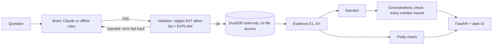

# Data Detective - Autonomous Analytics Agent

Ask a business question in plain English. The agent inspects the dataset, writes and **validates** SQL,
runs it read-only on DuckDB, draws Plotly charts, and explains the result with **traceable evidence**
(every number in the explanation is checked against the query output).

All data is **synthetic** (generated by `datagen.py`), so the whole project is safe to publish.

**No AI API key is needed.** The built-in offline engine parses the question, plans the investigation,
writes the SQL and narrates the findings deterministically. Claude is an optional drop-in upgrade.


## Try these

| Question | What the agent does |
|---|---|
| `Show me top sales by region` | **rank**: ranking query (with share-of-total window function) + monthly context trend |
| `Why did ROAS drop in Q3 2025?` | **diagnose**: monthly series -> seasonally-adjusted anomaly -> attribute the change by channel -> drill into the driver. Finds the planted *Paid Social / APAC+LATAM creative-fatigue* incident |
| `What happened to Email CTR in March 2024?` | finds the planted *email deliverability* incident and reports it as **broad-based** (every region and device fell ~60%) instead of blaming one segment |
| `Why did revenue spike in November 2024?` | recognises Black Friday as **seasonal** (same move a year earlier), not an incident |
| `Which campaigns have the highest CAC in 2025?` | ranking with "worst = highest" semantics for cost metrics |
| `Monthly revenue trend by channel` / `Weekly clicks for Email in 2024` | **trend** at day / week / month / quarter / year grain, optionally split by a dimension |
| `How much did we spend in 2024?` | **total**: KPI summary (revenue, spend, ROAS, conversions, CAC, CTR, CVR) + breakdown |
| `Compare 2024 vs 2025 revenue by channel` / `CTR year over year by channel` | **compare**: period vs period by dimension + overall change |
| `Which channel is most efficient?` | maps "efficient / ROI / profitable" to ROAS |

**Follow-ups** keep the conversation's context, e.g. `Revenue by region` -> `what about Europe only?` ->
`break that down by device` -> `and in 2024?`. After `Why did ROAS drop in Q3 2025?`, `what about CAC?`
investigates a CAC *rise* (the worsening direction for a cost metric). Each answer shows how the question was interpreted.

## Architecture



* **Two brains, one interface.** By default a deterministic rule-based brain with a semantic layer (`metrics.py`) runs the loop -
  no key, no network, so tests and CI need nothing. With `ANTHROPIC_API_KEY` set *and* `requirements-llm.txt` installed, Claude plans
  each SQL step and writes the findings instead. If the LLM call fails the agent falls back to the offline brain and says so in the trace.
* **Guardrails (defence in depth)**: single `SELECT` only, table allow-list, blocked file/system functions, forced `LIMIT`,
  `EXPLAIN` bind-check, read-only DuckDB connection with `enable_external_access=false`, 10 s query timeout.
  Failed SQL is fed back to the LLM for up to 2 repair attempts.
* **Traceability**: every finding cites evidence ids (`E1`...) that link to the exact SQL, row count and runtime.
  `evidence.verify_claim` re-derives each number (cells, sums, shares, MoM/YoY changes) and flags anything untraceable.
* **Detective logic**: anomaly months are scored after subtracting the same month-over-month move one year earlier,
  so Black Friday and January slumps are not mistaken for incidents. Changes are then attributed to segments: for additive
  metrics by each segment's share of the net change; for ratios (ROAS, CTR, CAC...) by the *rate effect*
  (change in the segment's ratio x its share of volume), so a tiny segment with a noisy ratio is never named as the driver.
  If every segment moved by a comparable amount the change is reported as broad-based rather than pinned on the largest segment.

## Quickstart (no API key)

macOS / Linux:

```bash
python3 -m venv .venv && source .venv/bin/activate
pip install -r requirements.txt
python -m data_detective.datagen     # builds data/marketing.duckdb (~400k rows, ~10 s; also built automatically on first use)
python -m pytest -q                  # 52 tests, no key or network needed
uvicorn data_detective.api:app --reload
# open http://127.0.0.1:8000
```

Windows PowerShell:

```powershell
py -m venv .venv
.\.venv\Scripts\Activate.ps1        # if blocked: Set-ExecutionPolicy -Scope CurrentUser RemoteSigned
pip install -r requirements.txt
python -m data_detective.datagen
uvicorn data_detective.api:app --reload
```

### Command line

```bash
python -m data_detective "Why did ROAS drop in Q3 2025?"          # one question
python -m data_detective --sql "Compare 2024 vs 2025 revenue by channel"   # also print the SQL evidence
python -m data_detective --json "Revenue by year"                # same JSON as POST /api/ask
python -m data_detective                                         # interactive session with follow-ups (/new, /quit)
```

### Optional: use Claude as the planner

```bash
pip install -r requirements-llm.txt
cp .env.example .env                 # then put your key in .env (never commit it)
```

## API

| Method | Path | Purpose |
|---|---|---|
| POST | `/api/ask` `{"question": "...", "history": ["earlier question", ...]}` | run the agent (`history` is optional, for follow-ups); returns findings, evidence, charts, trace |
| GET | `/api/schema` | columns + dataset profile |
| GET | `/api/examples` | suggested questions |
| GET | `/api/health` | status and active engine |
| GET | `/docs` | Swagger UI |

## Project layout

```
data_detective/
  datagen.py    synthetic data + planted anomalies -> DuckDB
  db.py         read-only warehouse, schema/profile inspection
  validator.py  SQL guardrails
  metrics.py    semantic layer (KPI definitions, formatting)
  offline.py    rule-based brain (parse + follow-ups -> SQL -> attribution -> narrate)
  claude.py     LLM brain (same interface)
  agent.py      plan -> validate -> execute -> repair -> explain -> verify
  evidence.py   evidence serialisation + groundedness check
  viz.py        Plotly chart selection
  api.py        FastAPI app, serves static/index.html
  __main__.py   command-line interface
tests/          validator, agent (incl. fake-LLM repair loop), API, CLI, offline eval set + follow-ups
```

## Ideas to extend

* Statistical anomaly detection (STL / z-score) as an agent tool
* Run the eval set (`tests/test_eval.py`) against the Claude brain to benchmark models
* Deploy to Render/Fly.io (the DuckDB file is regenerated on first start)
